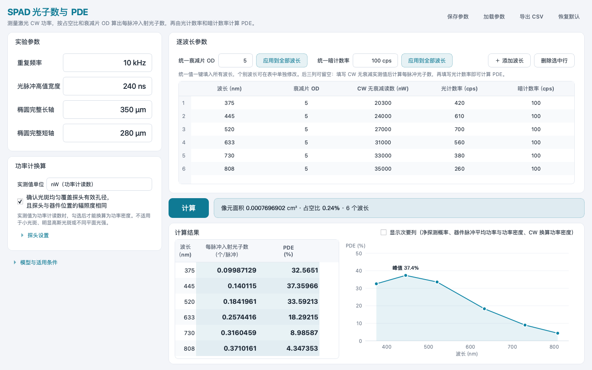

<p align="center">
  
</p>

<h1 align="center">SPAD-Power · SPAD 光子数与 PDE 计算器</h1>

<p align="center">
  <a href="https://github.com/hcy2206/spad-power/actions/workflows/ci.yml"></a>
  <a href="https://github.com/hcy2206/spad-power/releases/latest"></a>
  
  
  <a href="LICENSE"></a>
</p>

<p align="center">
  <b>测量激光 CW 功率，按占空比和衰减片 OD 算出每个脉冲入射到 SPAD 像元的光子数，再由光计数率和暗计数率计算光子探测效率（PDE）。</b>
</p>

> **English:** A small desktop calculator for single-photon avalanche diode (SPAD) experiments. Measure the laser power in CW mode without attenuation; the app combines it with the pulse duty cycle and the attenuator OD to give the mean number of photons incident on the pixel per pulse, then derives the photon detection efficiency (PDE) from the measured light and dark count rates using a Poisson model. The UI is in Simplified Chinese. Windows builds are on the [Releases](https://github.com/hcy2206/spad-power/releases) page.



## 下载

- **Windows：** 在 [Releases](https://github.com/hcy2206/spad-power/releases/latest) 页面下载 `SPAD-Power-<版本>-windows-x64.exe`，双击运行，无需安装 Python。程序未签名，首次运行若出现“Windows 已保护你的电脑”，点“更多信息”→“仍要运行”。
- **macOS / 其他平台：** 从源码运行，见[从源码运行](#从源码运行)。

程序是离线计算工具，不连接或控制激光器、功率计和 SPAD，也不采集仪器数据。

## 为什么是 CW 方案

脉冲模式下的平均功率极低（pW 量级），功率计难以测准。本方案在 CW（连续）模式、不加衰减片时测量激光功率，再按脉冲占空比 D = fτ 和衰减片 OD 换算到实际照射 SPAD 时的脉冲平均功率和每脉冲光子数。例如默认参数下（10 kHz、240 ns、OD5），375 nm 的 CW 功率计读数约 20.3 μW 时，每个脉冲约入射 0.1 个光子。

## 功能

- **每脉冲入射光子数：** 由各波长的 CW 无衰减实测值、占空比和衰减片 OD，计算每个脉冲平均入射到像元的光子数。
- **PDE 计算：** 输入照射时测得的光计数率和暗计数率，按泊松模型计算光子探测效率。
- **PDE 曲线：** 结果旁绘制 PDE 随波长变化的折线图，标出峰值，悬停可查看各波长的 PDE 和光子数。
- **多波长：** 同时计算多个波长；“统一衰减片 OD”和“统一暗计数率”一键填入所有波长，个别波长仍可单独修改。
- **实测值单位：** 功率计读数（nW，按探头孔径换算为功率密度）或功率密度（nW/cm²）。
- **记录与导出：** 保存和加载 JSON 参数，导出包含输入和全部结果的 CSV。

## 界面说明

界面采用浅色卡片式布局（固定为浅色主题，不随系统深色模式变化），标题栏右侧为保存、加载、导出和恢复默认。

- **左侧：** 实验参数（重复频率、脉宽、像元长短轴，大字号）；“功率计换算”卡片包含实测值单位和均匀覆盖确认，探头孔径收在“探头设置”中，模型说明收在“模型与适用条件”中，均默认折叠。
- **右上：** 逐波长参数——波长、衰减片 OD、CW 无衰减实测值、光计数率、暗计数率；上方可统一填入衰减片 OD 和暗计数率（输入后按回车或点“应用到全部波长”）。
- **右下：** 计算结果，左侧表格、右侧 PDE 曲线（横轴波长、纵轴 PDE，中间可拖动调整宽度）。表格中每脉冲入射光子数和 PDE 加粗突出；净探测概率、器件脉冲平均功率与功率密度、CW 换算功率密度为次要列，默认隐藏，可勾选“显示次要列”查看。无法计算的值显示为橙色“—”，鼠标悬停该行可查看原因，顶部摘要会注明有几个波长有提示；CSV 始终导出全部列（含提示）。

鼠标悬停在输入框和表头上可查看说明。快捷键：计算 Ctrl+Enter（Mac 为 Cmd+Return）、保存 Ctrl+S、加载 Ctrl+O、导出 Ctrl+E。修改参数后旧结果立即清空并显示橙色提示，避免导出过期结果；“恢复默认”会先确认再清除当前输入。

## 使用流程

1. 输入重复频率、实际光脉冲宽度，以及椭圆像元的完整长轴和短轴；程序显示占空比 D = fτ。
2. 把激光切到 CW 模式（与脉冲模式相同的驱动条件），不加衰减片，在器件位置用功率计测量各波长功率，填入“CW 无衰减实测值”。
3. 实测值为功率计读数时，勾选“确认光斑均匀覆盖探头有效孔径，且探头与器件位置的辐照度相同”，程序才会按探头孔径换算为功率密度；探头孔径可在“探头设置”中修改。
4. 插入衰减片、切回脉冲模式，记录 SPAD 的光计数率；关闭激光记录暗计数率。填入衰减片 OD 和计数率（各波长相同时用“统一衰减片 OD”“统一暗计数率”一键填入）。
5. 点击“计算”，结果表给出每脉冲入射光子数和 PDE，右侧曲线显示 PDE 随波长的变化；按需保存参数、导出 CSV。

## 输入与输出

| 输入 | 默认值 | 用途 |
|---|---|---|
| 波长 λ | 375、445、520、633、730、808 nm | 各波长独立计算，可增删 |
| 重复频率 f | 10 kHz | 占空比；把计数率换算为每脉冲探测概率 |
| 光脉冲高值宽度 τ | 240 ns | 占空比 D = fτ |
| 椭圆完整长轴 / 短轴 | 350 / 280 μm | 不是半轴；换算像元面积 |
| 衰减片 OD（逐波长） | 3 | 测计数时插在器件前的外置衰减片，填该波长处的实测 OD |
| CW 无衰减实测值（逐波长） | 留空 | CW 模式、不加衰减片时在器件位置测量；计算光子数和 PDE 必填 |
| 光计数率（逐波长） | 留空 | 插入衰减片、脉冲模式下 SPAD 的计数率（cps），填写后计算 PDE |
| 暗计数率（逐波长） | 留空 | 关闭激光、相同条件下的暗计数率（cps）；留空按 0 计算并提示 |
| 实测值单位 | nW（功率计读数） | 可切换为 nW/cm²（功率密度） |
| 探头有效孔径直径 | 9.5 mm | 功率计读数换算为功率密度，S130VC 参考值 |
| 确认均匀覆盖孔径且辐照度相同 | 默认未勾选 | 实测值为功率计读数时，勾选后才能换算 |

输出：像元面积、占空比；逐波长的每脉冲入射光子数、PDE（%），以及次要列中的每脉冲净探测概率、器件脉冲平均功率（pW）、器件脉冲平均功率密度（pW/cm²）、CW 无衰减功率密度（nW/cm²）；PDE 随波长的折线图；CSV 中另含各波长的提示。

## 计算模型与适用条件

取精确 SI 常数 h = 6.62607015e−34 J·s、c = 299792458 m/s：

- A = π × 长轴 × 短轴 / 4（统一换算为 cm²）；Eγ = hc/λ；D = fτ
- 实测值为功率计读数时，CW 无衰减功率密度 I_CW = 读数 / 探头有效孔径面积（需均匀覆盖）
- 器件脉冲平均功率密度 I = I_CW × D × 10^(−OD)；器件脉冲平均功率 P = I × A
- 每脉冲入射光子数 μ = P / (f × Eγ)
- 每脉冲净探测概率 p = (光计数率 − 暗计数率) / f
- 入射光子数服从泊松分布，p = 1 − exp(−PDE·μ)，故 **PDE = −ln(1 − p) / μ**（p 很小时 ≈ (光计数率 − 暗计数率)/(μf)）

**核心假设：脉冲模式下的高值功率等于 CW 功率**（矩形脉冲、相同驱动条件），因此脉冲平均功率 = CW 功率 × 占空比。半导体激光器在调制下可能因开关瞬态、热效应或驱动电路带宽，使实际脉冲高值功率偏离 CW 值，脉宽越短越明显；必要时应用快速探测器或其他方法核对。脉宽应为实际光脉冲宽度，电调制宽度未必相同；低值期间漏光忽略。

**PDE 的前提：** 按自由运行 SPAD、直接扣除暗计数处理；未修正死时间、后脉冲和计数饱和，计数率应远低于重复频率和死时间上限。p ≤ 0 或 p ≥ 1 时不计算；PDE 超过 100% 时提示检查 OD、CW 实测值或计数率。μ 的准确度（CW 功率、OD、像元面积）直接决定 PDE 的准确度。

像元区域内照明近似均匀。功率计换算要求光斑均匀、完全覆盖探头有效孔径，且测量处和器件处辐照度相同；不适用于直接按孔径面积换算小光斑、明显高斯光斑或不同平面光强。OD 应使用对应波长的实测值，不能把单波长标称 OD 无条件套到所有波长；衰减片指外置滤片，不是功率探头自身已校准的内置滤片。更改重复频率、脉宽或激光驱动条件后，应重新测量 CW 功率。

**验证基准：** 默认参数（10 kHz、240 ns、350 × 280 μm）下像元面积 7.696902e−4 cm²、占空比 0.24%。375 nm、OD3 时，CW 无衰减功率密度 286.7598 nW/cm²（9.5 mm 探头读数约 203.26 nW）对应每脉冲 0.1 个入射光子；此时光计数率 500 cps、暗计数率 100 cps 给出 PDE ≈ 40.82%。

## 参数文件与导出

参数保存为 JSON（当前为第 6 版格式）。旧版文件可直接加载：不再使用的设置（目标光子数、可变 OD 范围、探头参考下限、第 1 版的“最终固定总 OD”）会被忽略；第 1～3 版中的实测值是脉冲平均值，加载时按 ÷ 占空比换算为 CW 值；第 1、2 版的实测值按 nW/cm² 解读。CSV 使用 UTF-8 BOM（可直接用 Excel 打开），包含本次输入和全部结果列。

## 从源码运行

先安装 [uv](https://docs.astral.sh/uv/getting-started/installation/)，在项目目录运行：

```sh
uv sync --locked --group dev
uv run spad-power        # 或 uv run python -m spad_power
uv run pytest            # 运行测试
```

首次同步需要网络；之后运行使用项目虚拟环境。Python 默认 3.12（项目声明支持 3.12–3.14，CI 在 3.12 上测试）。

## 打包与发布

Windows exe 必须在 Windows 上构建（PyInstaller 不支持交叉打包）。

- **本地打包：** 在 Windows 安装 uv，双击 `build-windows.bat`，或运行 `uv run python scripts/build_windows.py`，输出 `dist/SPAD-Power.exe`。构建机器需要网络下载依赖。
- **GitHub Actions：** 推送到 `main` 或提交 PR 时，[Tests](.github/workflows/ci.yml) 会在 Windows 和 macOS 上运行测试；在 Actions 页面手动运行 [Windows build & release](.github/workflows/windows.yml) 可得到 exe 构建产物。
- **发布新版本：** 修改 `spad_power/__init__.py` 中的 `__version__`，在 `CHANGELOG.md` 添加对应版本的条目，提交后推送标签（如 `git tag v0.2.0 && git push origin v0.2.0`）。工作流会检查标签与版本号一致，运行测试、打包，并自动创建 GitHub Release（说明取自 CHANGELOG）。

程序图标由 `scripts/make_icon.py` 生成（`uv run python scripts/make_icon.py`）。exe 未签名，签名证书不包含在本项目中。

## 项目结构

```text
spad_power/
  model.py                 光子数与 PDE 的计算模型（无界面依赖）
  app.py                   图形界面、参数保存/加载、结果导出
  chart.py                 PDE 随波长变化的折线图
  assets/                  程序图标
  __init__.py              版本号
  __main__.py              Python 模块启动入口
tests/                     计算模型与界面功能测试
scripts/
  build_windows.py         Windows 打包脚本
  release_notes.py         从 CHANGELOG 提取 Release 说明
  make_icon.py             生成程序图标
build-windows.bat          Windows 一键构建入口
.github/workflows/         测试与 Windows 构建/发布流程
docs/interface.png         界面截图
CHANGELOG.md               更新日志
```

## 参考

- [uv 项目管理](https://docs.astral.sh/uv/guides/projects/)
- [Qt / PyInstaller 部署](https://doc.qt.io/qtforpython-6/deployment/deployment-pyinstaller.html)
- [Thorlabs S130VC 参考规格](https://www.thorlabs.com/catalogpages/V21/1561.PDF)：9.5 mm 孔径及 500 pW 参考下限。请按所用探头和功率计的实际校准、量程核实。

## 许可证

[MIT](LICENSE) © 2026 hcy2206
